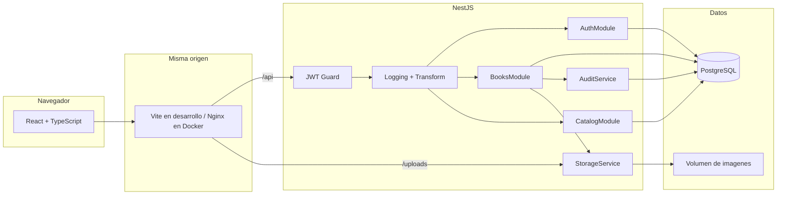

# Arquitectura — CMPC Libros

## Decisiones

- **Monolito modular.** Un servicio HTTP con módulos Nest (auth, libros, catálogo, auditoría, storage, prisma). Encaja con el tamaño del dominio y deja extraer módulos si el catálogo crece.
- **Catálogo normalizado.** Autor, editorial y género son entidades propias. El alta reutiliza un nombre existente (sin distinguir mayúsculas) o lo crea dentro de la misma transacción que el libro y su registro de auditoría.
- **Disponibilidad y stock separados.** `available` es la decisión comercial (se ofrece o no). `stock` es la cantidad física. El filtro de disponibilidad usa el booleano.
- **Soft delete.** `deleted_at` excluye el libro de listados, detalle, edición y exportación. No se reutiliza el id.
- **Contrato de respuesta.** Un interceptor envuelve las respuestas JSON en `{ success, data, meta? }`. CSV y archivos estáticos quedan fuera de ese sobre.
- **Auditoría de negocio en la misma transacción** que la mutación. Un interceptor aparte registra el acceso HTTP (método, ruta, estado, duración, usuario) en el log de proceso.
- **Imágenes en disco local** con volumen Docker. La URL pública es `/uploads/:archivo`, servida por la misma origen que la SPA mediante proxy. En un entorno real ese adaptador se reemplaza por object storage sin cambiar el contrato del libro.
- **Precios en CLP** con dos decimales permitidos, aunque el catálogo semilla usa pesos enteros.
- **Un rol operativo.** El modelo incluye `ADMIN` y `STAFF`, pero esta entrega autentica un administrador. El guard ya distingue rutas públicas y autenticadas para sumar RBAC después.
